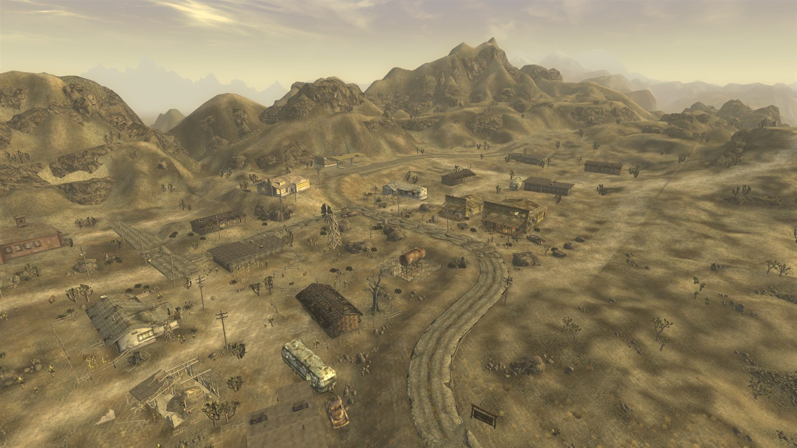
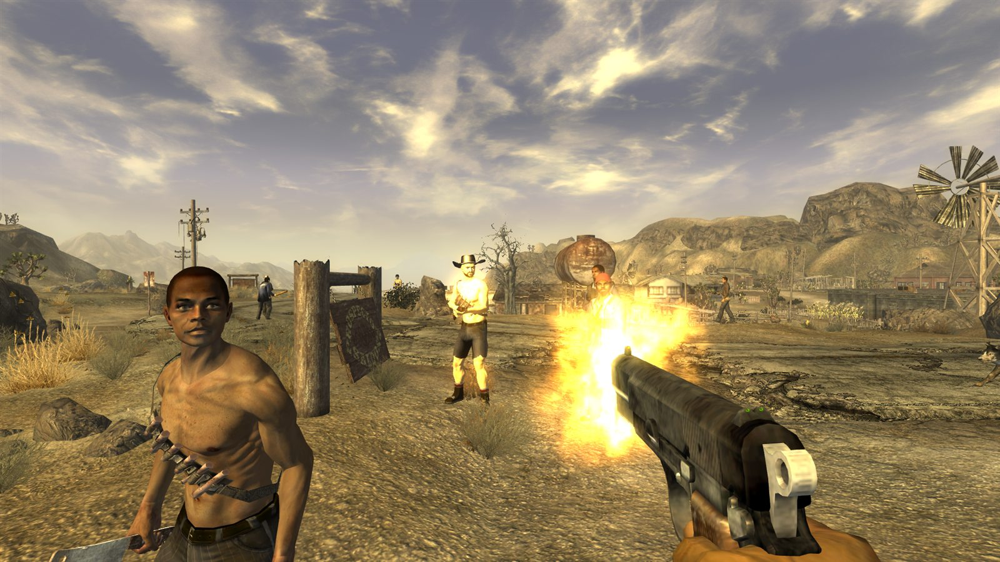

<p align="center">
  
</p>

<h1 align="center">nv-rs</h1>

[](https://www.rust-lang.org/)
[](https://bevyengine.org/)
[](LICENSE)
[](docs/PLAYTESTING.md)
[](docs/MILESTONES.md)

**Fallout: New Vegas, rebuilt in Rust, aiming to play exactly like the
original.**

nv-rs is a new engine for Fallout: New Vegas, written in Rust with the Bevy
engine. It runs the game from your own copy's files, and its goal is a
faithful 1:1 match, down to the original's quirks. The goal is not to make a
"remake" that feels close. It's to make the same game, on a modern,
open-source engine that can be fixed, ported and extended.

<p align="center">
  
  <br><sub><i>Goodsprings, rendered by nv-rs from the game's own files.</i></sub>
</p>

> [!IMPORTANT]
> nv-rs is an independent project, not affiliated with or endorsed by
> Bethesda Softworks, ZeniMax Media, Obsidian Entertainment or Microsoft. It
> contains no game files; you need your own legally obtained copy of the game.
> See [LEGAL.md](LEGAL.md).

---

## Why it's different

- **Behaviour comes from the original, not from guesswork.** Rules, formulas
  and timings are taken from the original game itself and checked against
  it. Nothing is tuned by eye.
- **Your game, your files.** nv-rs reads the game's own plugins, meshes,
  textures, sounds and menus directly from your installation. It never
  modifies them.
- **Built to last.** Open source, memory-safe Rust, with the game's rules
  kept separate from graphics, so new platforms, fixes and even VR are
  possible later.
- **Mods keep working.** Regular `.esp` and `.esm` mods load the way they do
  in the original.

## Where it stands (October 2026)

Experimental, but already playable in places:

- **The opening and Goodsprings:** Doc Mitchell's house, character creation,
  Goodsprings with its people going about their day, and the quests *Back in
  the Saddle* and *Ghost Town Gunfight*.
- **Systems in play:** combat, NPC AI and navigation, dialogue, barter, the
  Pip-Boy, the radio, physics and ragdolls, terminals and hacking.
- **The engine port:** about a quarter of the original game's code has been
  carefully ported so far. Since Build 42 it runs inside the game, starting
  with quests, which now load and run on the original's own logic.

<table>
  <tr>
    <td width="50%"></td>
    <td width="50%"></td>
  </tr>
  <tr>
    <td align="center"><sub><i>Waking up in Doc Mitchell's house.</i></sub></td>
    <td align="center"><sub><i>Ghost Town Gunfight: the Powder Gangers come to town.</i></sub></td>
  </tr>
</table>

Not yet: a full playthrough, loading original saves, script-extender (NVSE)
plugins, Linux and macOS, and VR.

## Progress

<p align="center">
  
</p>

The original game's systems switch over one at a time, each in its own
playable build:

| | System | Status |
| :---: | --- | --- |
| ✅ | **Foundations:** the map of the original program, the frame order, the engine running in play | Done (Build 42) |
| 🔨 | **Movement and physics:** how walking, jumping and collisions feel | In progress: all 9,011 Havok functions translated (739 of them still have a marked untranslated part, mostly C++ exception frames), physics about 97%; wiring the game's own physics into play is under way |
| 🔨 | **Animation and faces** | Started: about 15% translated |
| ⬜ | **Audio:** sounds, music and the radio | About two-thirds translated |
| 🔨 | **Graphics:** lighting, weather and effects matching the original | Started: trees (SpeedTree) translated; the game's own renderer is being translated to run on our own Direct3D 9 layer ([ADR-0007](docs/adr/0007-renderer-translated-on-own-d3d9-layer.md)); about a quarter done |
| ⬜ | **Gameplay:** combat, AI, quests, dialogue, menus, V.A.T.S., perks, crafting and minigames | About two-thirds translated, not yet switched on |
| ⬜ | **Saves and the open world:** original saves, world streaming | Planned |

After that come optional bug fixes, script-extender compatibility and more
platforms. Every system, with numbers, is in
[docs/SYSTEMS.md](docs/SYSTEMS.md), and the milestones are in
[docs/MILESTONES.md](docs/MILESTONES.md).

---

## Try it

1. Download the latest Windows build from
   [Releases](https://github.com/slaterain/nv-rs/releases).
2. Extract it and run `Play.cmd`.
3. Point it at your own `Fallout New Vegas\Data` folder.

nv-rs needs Fallout: New Vegas version 1.4.0.525 installed. Tips for testing
and reporting are in [docs/PLAYTESTING.md](docs/PLAYTESTING.md). If anything
behaves differently from the original game, that's a bug worth reporting.

### Build from source

Install stable Rust, then:

```sh
cargo build --release && cargo test --workspace
cd viewer
cargo run --release -- "<path to Fallout New Vegas\Data>" GSDocMitchellHouse
```

---

## How it's made

To be upfront: nv-rs is built almost entirely with AI coding agents (mainly
Claude, with some Codex). The maintainer directs the project: setting the plan
and priorities, playtesting builds and deciding what gets merged. The agents
write nearly all of the code.

What keeps it honest is the method. Agents don't get to invent behaviour:
every ported piece of logic is traced to the original game's code and marked
with where it came from. It is then checked by more than 20,000 automated
tests, by automated play-throughs of the opening and the Goodsprings quests on
every change, and against the original game itself. Anything that can't be
traced to the original doesn't go in. Everything is in the open, so judge it by
how it plays.

---

## Get involved

Contributions are welcome, from people and their AI agents alike:

1. Read [CONTRIBUTING.md](CONTRIBUTING.md) (and give [AGENTS.md](AGENTS.md)
   to your agent).
2. Open an issue saying what you'd like to work on, and wait for a
   go-ahead from the maintainer.
3. Open a small pull request against `main`.

The most useful help right now: testing builds and reporting differences from
the original, platform support, playthrough routes and research into how the
original behaves.

**Curious how it works?** Start with
[docs/ENGINE_PORT_PLAN.md](docs/ENGINE_PORT_PLAN.md) and
[docs/METHODOLOGY.md](docs/METHODOLOGY.md). Progress is tracked in
[docs/LEDGER.md](docs/LEDGER.md) and [docs/MILESTONES.md](docs/MILESTONES.md),
and every other document is linked from [docs/](docs/).

Final decisions rest with the maintainer, **slaterain**
([docs/GOVERNANCE.md](docs/GOVERNANCE.md)).

## Legal and license

Original code is licensed under the [GNU GPL v3 or later](LICENSE). The
licence covers only original work. Fallout and Fallout: New Vegas are trademarks of their respective owners.
Read [LEGAL.md](LEGAL.md) for the full notice.
